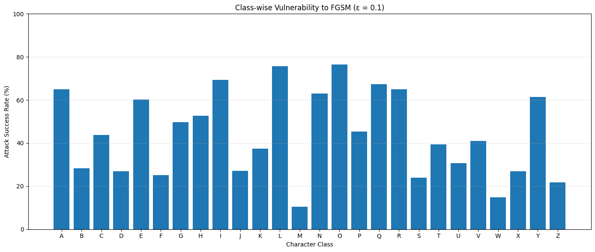
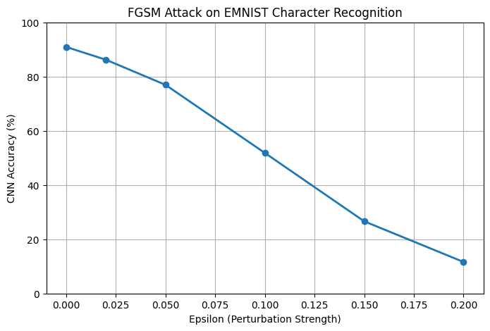
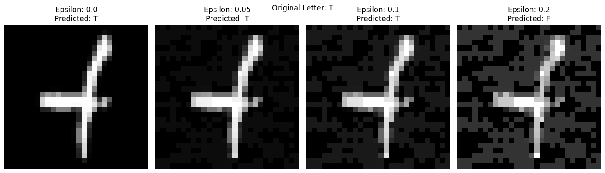

# Adversarial Vulnerability Analysis and Robustness Evaluation of CNN-Based Character Recognition

> A small, independently executed **adversarial machine-learning experiment**, not a proposal for a new attack algorithm or a certified defense.

This project studies how gradient-based adversarial perturbations affect a CNN trained to classify handwritten letters. It implements **FGSM** and **projected gradient descent (PGD)**, measures vulnerabilities by character class, and evaluates whether additional mixed clean/adversarial fine-tuning improves robustness.

## Key results (held-out test set)

All metrics below are taken from the completed Google Colab notebook using the **20,800-image EMNIST Letters test set**, with attacks generated **against each model independently**. Attacks use an `L∞` input perturbation budget of `ε = 0.1` on pixels normalized to `[0,1]`.

| Metric | Baseline CNN | FGSM fine-tuned CNN | Difference |
|:--|--:|--:|--:|
| Clean accuracy | 90.72% | **91.93%** | +1.21 percentage points |
| FGSM accuracy | 52.51% | **72.33%** | +19.82 percentage points |
| PGD accuracy | 32.30% | **62.50%** | +30.20 percentage points |
| FGSM attack success rate | 42.12% | **21.32%** | −20.80 percentage points |
| PGD attack success rate | 64.39% | **32.01%** | −32.38 percentage points |

**Main observation:** The fine-tuned model retained 62.50% accuracy under the evaluated PGD attack versus 32.30% for the baseline. This is evidence of **improved performance under the specific attacks tested**, not proof of security against arbitrary attacks.



## Model and dataset

- **Dataset:** EMNIST `letters` split; grayscale `28×28` images, 26 classes. Labels are remapped from `1…26` to `0…25`.
- **Partitioning:** Original 124,800 training images split into **112,320 train** and **12,480 validation** examples using `random_split` with seed `42`. Separate official **20,800 test** images held out for final reporting.
- **Input:** tensors of shape `(N, 1, 28, 28)` with pixel range `[0,1]`.
- **CNN:** `Conv2d(1,32,3,padding=1)` → LeakyReLU(0.01) → MaxPool2d(2) → `Conv2d(32,64,3,padding=1)` → LeakyReLU(0.01) → MaxPool2d(2) → Flatten → Linear(3136,128) → LeakyReLU(0.01) → Linear(128,26).
- **Baseline optimization:** cross-entropy + Adam (`lr=1e-3`), one manual single-batch update followed by **one full training epoch**.
- **Defense:** deep copy of the baseline, an additional manual single-batch update and **one full fine-tuning epoch** using `0.5 × clean CE + 0.5 × adversarial CE`, Adam (`lr=1e-4`), FGSM `ε=0.1` generated against the then-current defended model.

## Threat model and attacks

**Threat model:** An untargeted, **white-box**, label-aware attacker has access to the classifier and its gradients and seeks to increase cross-entropy loss without changing the true class. Each input pixel may change by at most `ε` in normalized intensity (`L∞` constraint), with pixels clipped to `[0,1]`. The attack need not preserve perfect human readability, especially at larger epsilon values.

- **FGSM:** One gradient-sign step, `x_adv = clip(x + ε·sign(∇ₓCE(f(x), y)), 0, 1)`.
- **Initial PGD (validation):** 10 steps, `α=0.02`, `ε=0.1`, fixed starting point.
- **Final PGD (test):** **40 steps, `α=0.01`, `ε=0.1`, three random restarts** from the allowed perturbation region. The highest final cross-entropy-loss candidate for each example is selected. After each step, the attack is projected back into the `L∞` ball and valid pixel interval.

**Attack success rate (ASR)** here counts images that were correctly classified when clean, but were misclassified after attack, divided by the number classified correctly when clean. Its denominator is **not** the whole dataset.

## Validation investigations

The notebook also varies FGSM epsilon and measures class-wise susceptibility **on validation only**, before the final held-out evaluation.

| FGSM ε | Baseline accuracy (validation) | FGSM ASR (validation) |
|--:|--:|--:|
| 0.00 | 90.92% | 0.00% |
| 0.02 | 86.21% | 5.18% |
| 0.05 | 76.95% | 15.37% |
| 0.10 | 51.83% | 42.99% |
| 0.15 | 26.62% | 70.72% |
| 0.20 | 11.63% | 87.22% |

At `ε=0.1`, the largest observed class-wise FGSM ASRs were **O (76.38%)**, **L (75.76%)**, and **I (69.41%)**; the smallest were **M (10.38%)** and **W (14.83%)**. These are measured susceptibilities, **not established causes**. Variation could reflect learned features, visual similarity, baseline confidence, class balance after clean-correct conditioning, or randomness.





## Repository layout

```text
.
├── README.md
├── requirements.txt
├── .gitignore
├── notebooks/
│   └── CNN_Adversarial_Robustness.ipynb
├── results/
│   ├── final_adversarial_results.csv
│   ├── fgsm_epsilon_sweep_validation.csv
│   └── fgsm_classwise_validation.csv
└── figures/
    ├── classwise_fgsm_vulnerability_validation.png
    ├── fgsm_epsilon_accuracy_validation.png
    └── adversarial_example_validation.png
```

## Running the notebook

1. Open `notebooks/CNN_Adversarial_Robustness.ipynb` in **Google Colab** (GPU recommended but not mandatory).
2. Use an environment with PyTorch, torchvision, NumPy, Matplotlib and pandas. On Colab these are usually preinstalled; install missing dependencies using the supplied `requirements.txt`. Ensure PyTorch/torchvision versions match your CUDA runtime.
3. Run the notebook **top to bottom**. EMNIST is downloaded by torchvision; it is **not** distributed in this repository. The interactive notebook contains additional one-batch training steps and expects its original execution order. Executing training cells twice changes model weights.
4. The `google.colab.files.download` cell works only in Colab and downloads `baseline_cnn.pth` and `defended_cnn.pth` from that runtime. These checkpoints are **not included in this repository package**, because only the notebook was supplied for repository preparation. If you have the original checkpoint files, add them separately (consider Git LFS if they are large).
5. Full test evaluation includes **two models × 20,800 images × three 40-step PGD restarts** and may be time-consuming, even with a GPU.

### Reproducibility notes

The train/validation split is seeded (`42`), and the final random PGD evaluation is seeded (`42`), but the **CNN weights, initial DataLoader shuffling and manual updates were not seeded from the start** in the recorded run. Hardware and framework version details were not completely captured. As a result, a fresh end-to-end rerun can produce different numbers; the CSV and notebook outputs document the **observed results** from the uploaded session. A more reproducible follow-up should seed Python, NumPy, Torch and DataLoader generators *before* model initialization and pin library versions.

## Limitations and next experiments

- **Unequal training budget:** The defended CNN was fine-tuned longer than the baseline CNN. A **matched clean-only fine-tuning control** is needed to estimate how much improvement comes specifically from adversarial training rather than additional optimization.
- **Single run:** No variance estimates across model training seeds; differences are not established as statistically stable.
- **Attack coverage:** FGSM and a particular PGD setup were evaluated. Stronger attacks (e.g., AutoAttack) or alternate threat models might reveal remaining vulnerabilities; these results are **not a robustness guarantee**.
- **Image semantics:** A pixel-space budget of `0.1` may be visible on small glyphs; no human recognizability study was performed.
- **Domain limits:** EMNIST does not represent natural deployment conditions for OCR systems on historical inscriptions.

## Credits / foundational methods

Implemented for an educational adversarial-ML security experiment; established techniques are credited rather than presented as new inventions.

- Cohen et al., *EMNIST: Extending MNIST to handwritten letters*, 2017 — https://arxiv.org/abs/1702.05373
- Goodfellow et al., *Explaining and Harnessing Adversarial Examples*, 2015 — https://arxiv.org/abs/1412.6572
- Madry et al., *Towards Deep Learning Models Resistant to Adversarial Attacks*, 2018 — https://arxiv.org/abs/1706.06083

## Intended scope

A concise demonstrator of practical ML attack surfaces, controlled attack evaluation and defensive fine-tuning; **not** a novel attack method, certified defense, or peer-reviewed research article.